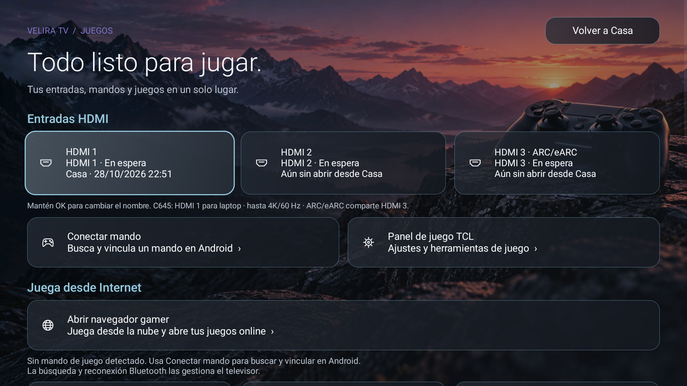
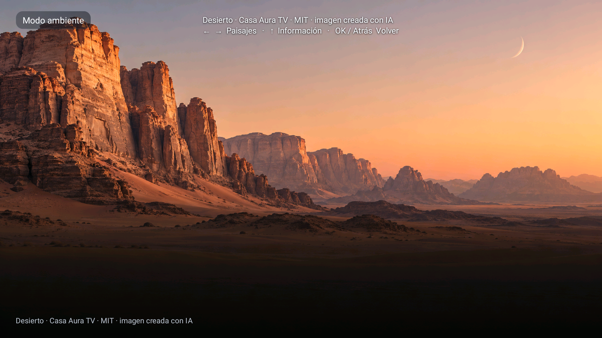

# Auditoría y correcciones · candidata 0.11

1 de noviembre de 2026. Se revisaron el refinamiento de los tres inicios y el rediseño de Ambiente/Juegos contra código y capturas. No estaban completos en todos sus criterios: el fondo de Juegos era un desierto reutilizado y no el mando de la referencia. Las integraciones no se habían verificado íntegramente. Los documentos de la etapa anterior se conservan sin reescribirlos.

## Correcciones implementadas

- Fondo específico de Juegos incorporado al APK, con decodificación RGB565 fuera del hilo UI. Imagen nueva generada, no recuperación de la referencia; sin filtros animados ni nuevas peticiones. Verificación del APK exige este recurso para evitar un fondo de sustitución silencioso en una compilación incompleta.
- Colores, tiempos de foco y constantes principales centralizados en AuraTheme. Alto pasa de 220 a 200 ms. Violeta discreto en Juegos. Consolidación parcial: falta migrar todas las dimensiones, tipografías y mensajes.
- Ambiente permite ocultar fecha/hora desde Aspecto, con preferencia validada e incluida en las copias de apariencia. Arriba presenta el crédito completo junto a la ayuda temporal.
- No se acepta otra transición de foto hasta terminar la activa, evitando solapamientos de las dos vistas. Se conservan dos imágenes y la precarga anterior.

## Verificación

Compilación firmada y contrato del APK aprobados. Pruebas de opciones, juegos y online aprobadas, incluida validación estricta del nuevo booleano. TV conectada, instalación con datos conservados; captura de Juegos revisada en 1920×1080. Se probó ocultar el reloj, abrir la vista previa y mostrar la información; la captura confirma el resultado. Después se restauró Reloj y fecha · visibles, comprobado en Ajustes. Sin pruebas prolongadas. Las cifras de 123 frames de la etapa anterior no se atribuyen a esta compilación.

No se certifican 4K, todos los niveles, emparejamiento físico, señal de los tres HDMI ni ausencia de fugas. No hay benchmark equivalente nuevo. El arranque frío observado al abrir Inicio tras instalar fue 2726 ms; un caso aislado sin comparación, no prueba de aceleración.

La incidencia previa de system_server continúa abierta. La candidata no se convierte en release estable por esta revisión. [Sistema visual y pendientes](../../../SISTEMA-VISUAL.es.md).
