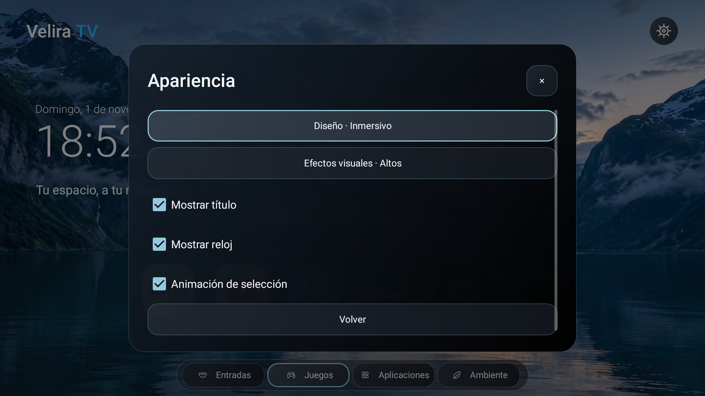
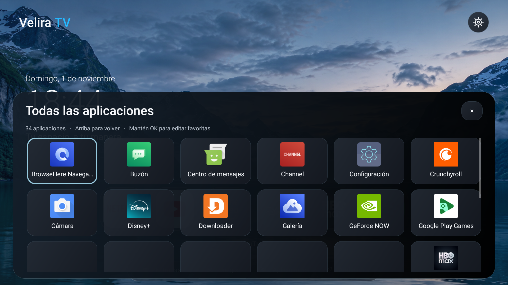
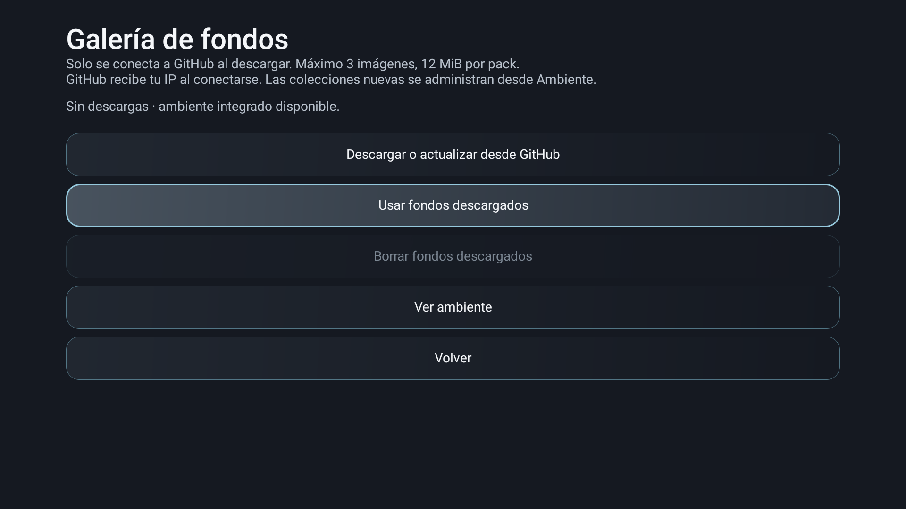
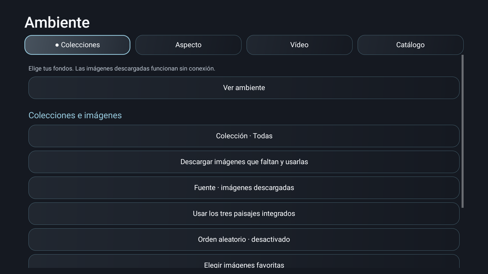
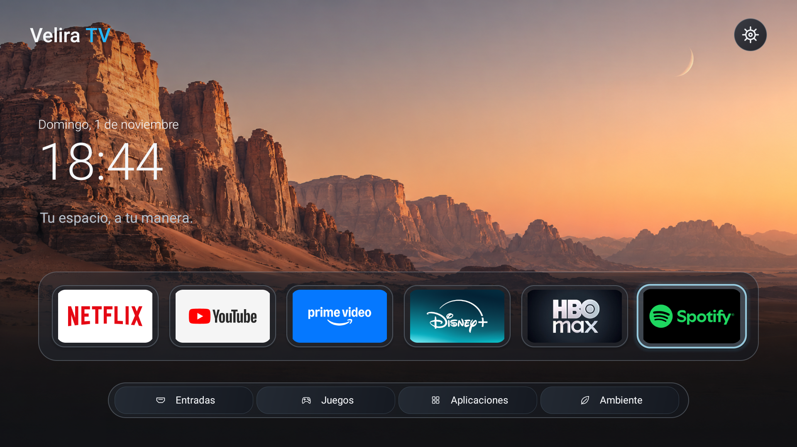
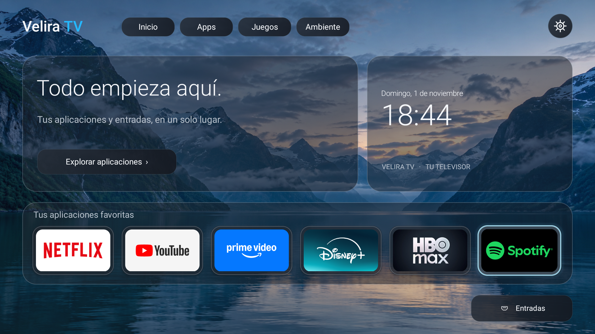
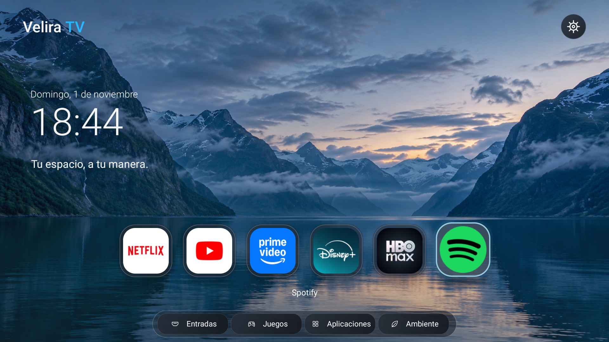

# Consolidación de los pendientes visuales · 0.11 candidata

1 de noviembre de 2026. Se implementan las cuatro fases del encargo visual, con las validaciones externas y el fallo nativo separados del código terminado. No se declara resuelto todo el sistema TCL ni se publica una release estable.

## Trabajo terminado en código

| Fase | Resultado |
| --- | --- |
| Sistema común | VisualTokens, VisualUi y AuraTheme comparten paleta, tipografía base, superficies, estados y tiempos. El tema XML nativo utiliza la misma paleta, con verificación automática de coherencia. El foco oscuro permite leer las etiquetas pequeñas; normal y deshabilitado tienen colores de texto distintos. |
| Ajustes y biblioteca | Ventanas preparadas antes de mostrarse; diálogos comunes con retorno de foco. Biblioteca con IDs estables por paquete, selección conservada al actualizar, carga, vacío, error y reintento. |
| Galería y secundarios | Galería anterior migrada al tema común, lectura fuera de UI y cancelación de red fuera de UI; reentrada recuperable aun si se cancela antes de arrancar el trabajador. Catálogos ausentes muestran explicación; pestañas seleccionadas y controles deshabilitados son visibles. Imagen TCL y navegador conservan sus acciones. |
| Validación | Suites JVM, contrato del APK, capturas y regresión en C645. Pruebas reales de foco, casos con cero/una favorita, copias y reentrada. Escala 4K comprobada por cálculo; no se confunde con un televisor 4K renderizando la interfaz. |

También se corrigió el solapamiento del botón vacío en Moderno, el foco inicial de la biblioteca vacía y la aceptación de schema como cadena en las copias. Las preferencias originales de los ensayos se restauran en finally. No se borran favoritos, descargas ni datos del usuario.

## Pruebas efectuadas

- Home, opciones de visualización, galería, controles TCL, juegos y transporte online: aprobadas.
- test-visual: contraste mínimo 4,5:1 en superficies definidas, incluidos fondos enfocados; límites de efectos; escala 1080p/4K y formatos no 16:9; concordancia de colores Java/XML: aprobado.
- Parser real de copias: acepta favoritas vacías/una favorita y rechaza duplicados, booleanos de otro tipo y schema de tipo incorrecto. No se restaura una copia de prueba sobre los datos del usuario.
- TV: tres presets, foco de favoritas/utilidades, biblioteca y centro de control, cero/una favorita, reentrada de galería cancelada antes de ejecutar el trabajo, colecciones locales: aprobados.
- Estado normal/deshabilitado de texto nativo: aprobado.
- Compilación firmada y verificación del APK: aprobadas. El auxiliar temporal se retira después de probar.

La prueba de reentrada simula callbacks controlados sobre la misma instancia; no sustituye una suspensión física. Las capturas acreditan las pantallas fotografiadas, no todos los diálogos posibles. Los últimos cambios de paleta se comprobaron en el contrato de contraste y compilación; la comparación de dibujo inferior precede ese ajuste cromático.

## Comparación breve de dibujo

Misma secuencia de biblioteca, centro de control y foco de seis favoritas, dos calentamientos antes de una muestra. Misma C645, firmware, preferencias y resolución. Sin vídeo ni descargas. Una muestra por versión; no una distribución estadística completa.

| Dato | Candidata anterior | Consolidación |
| --- | ---: | ---: |
| Fotogramas | 82 | 82 |
| Lentos | 2 (2,44 %) | 2 (2,44 %) |
| Mediana CPU | 7 ms | 5 ms |
| p95 CPU | 10 ms | 10 ms |
| p99 CPU | 48 ms | 34 ms |
| Mediana GPU | 7 ms | 7 ms |
| p95 GPU | 19 ms | 19 ms |

El p99 GPU devolvió un valor extremo de histograma de 4950 ms en ambas muestras: no se utiliza para concluir rendimiento real. No se anuncia una aceleración general ni una reducción de RAM. El p95 de CPU y los frames lentos permanecieron iguales.

## Capturas reales

### Ajustes

### Biblioteca

### Galería y colecciones

### Los tres modos

## No se puede dar por terminado con este hardware y estas pruebas

1. **Caída histórica de Android:** SIGSEGV de system_server/android.anim en ART/InsetsController al cambiar ventanas durante el ensayo multimedia anterior. La secuencia actual no reprodujo esa caída; eso no demuestra que esté resuelta. La instrumentación además emite una advertencia EGL del driver al finalizar; se conserva como observación y no se interpreta como fallo Java de Velira ni como prueba de estabilidad nativa. Es un bloqueo de la release estable.
2. **Validación física pendiente:** la interfaz real del TV está a 1920×1080. No se certifica renderizado físico 3840×2160, otras marcas/firmwares, mandos externos ni señal de los tres HDMI con todas las fuentes/HDR. Los cálculos de escala no sustituyen esos equipos.
3. **Estabilidad prolongada:** no se repiten pruebas largas ni el estrés multimedia fallido. Este usuario pidió verificaciones puntuales. No se afirma ausencia de fugas o comportamiento de todas las redes y códecs.

Estas limitaciones no se renombran como pruebas aprobadas. Las funciones futuras del roadmap —HLS/DASH, integración oficial de YouTube, traducción completa, Gradle y portabilidad— tampoco se añaden a escondidas a este refinamiento.

[Contrato visual](../../../SISTEMA-VISUAL.es.md) · [Archivo de etapas](../../README.md).
