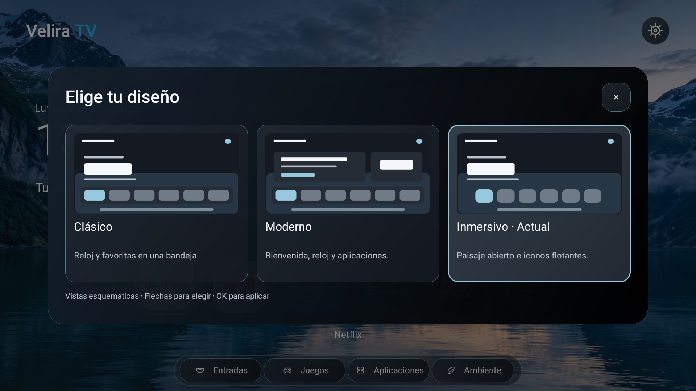
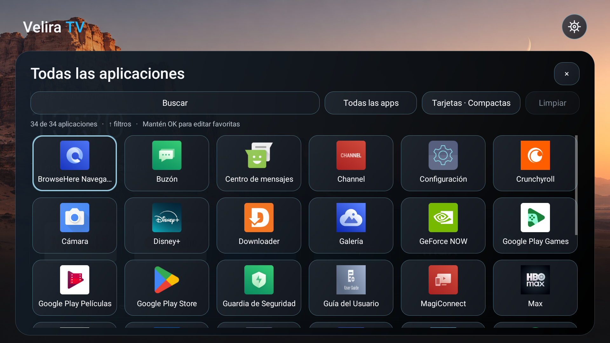
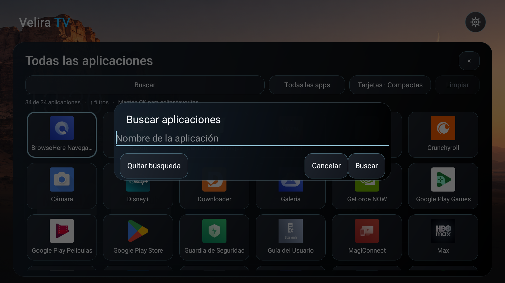
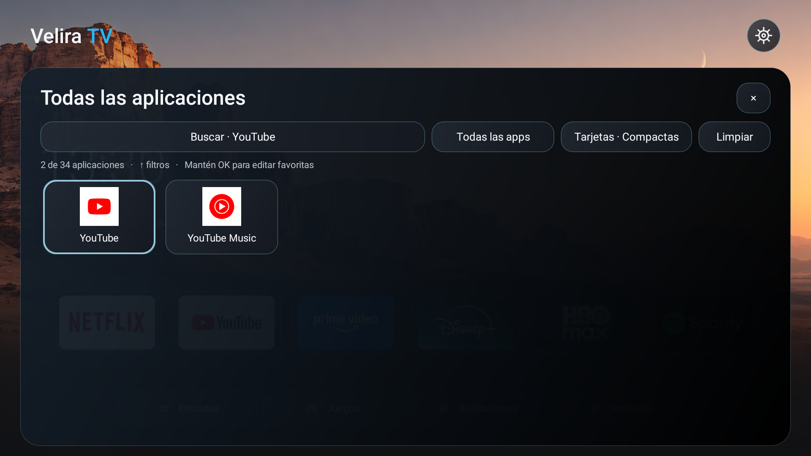
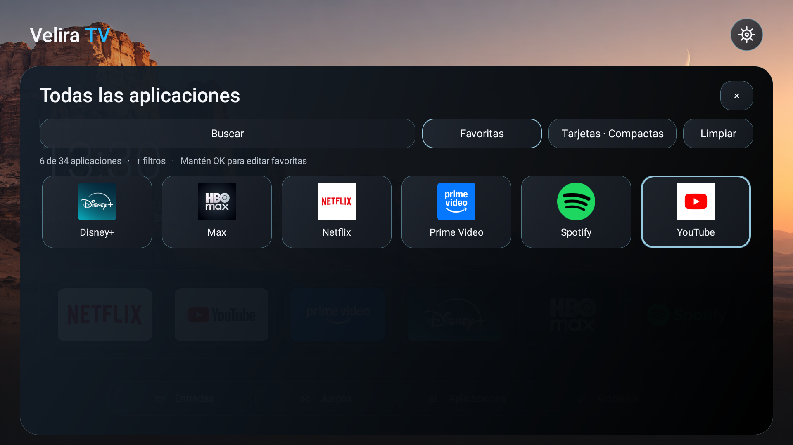
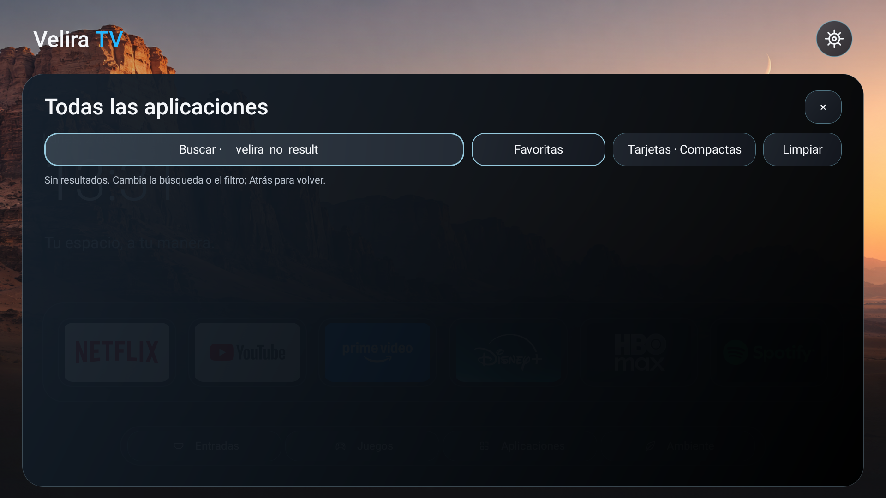
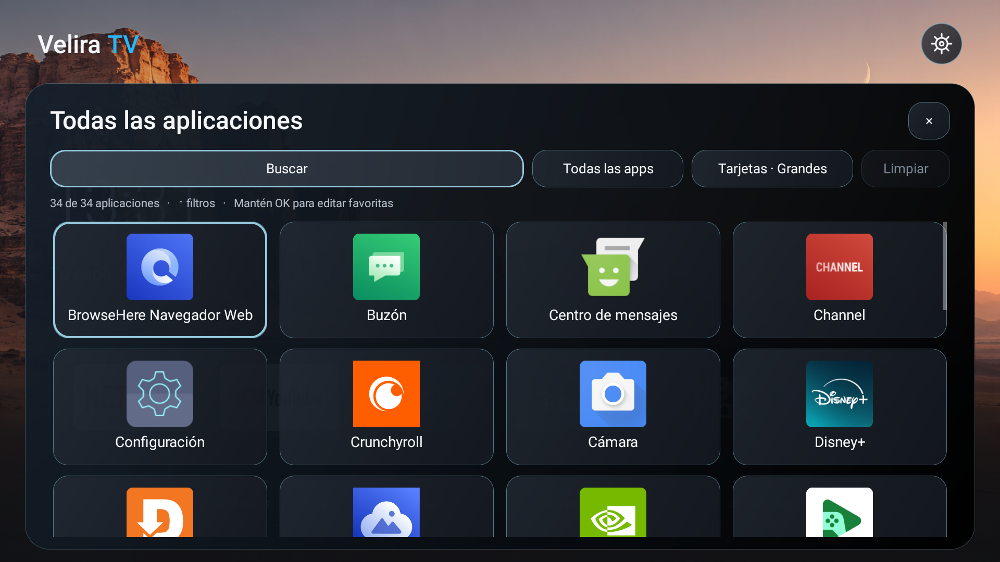

# Velira TV 0.12 · diseño y biblioteca

2 de noviembre de 2026. Nueva candidata de desarrollo. Conserva paquete, firma, favoritas y ajustes. La estable pública sigue en 0.10.0; la candidata 0.11 permanece archivada.

## Novedades

### Selector visual de diseños

Ajustes → Apariencia → Diseño abre tres tarjetas: Clásico, Moderno e Inmersivo. Muestran esquemas nativos de su composición y marcan el diseño actual. Flechas para comparar, OK para aplicarlo, Atrás para cancelar. Los esquemas no son capturas ni renderizan tres inicios simultáneamente.

### Biblioteca con búsqueda local

La barra superior permite buscar por nombre o identificador de paquete. Ignora mayúsculas y tildes, limita la consulta a 80 caracteres y conserva el orden de la lista. La búsqueda se confirma desde el teclado nativo; no se envía a Internet.

### Filtro de favoritas y estados vacíos

Favoritas muestra solo las aplicaciones guardadas en Inicio que siguen instaladas. Limpiar quita búsqueda y filtro. No altera el orden ni la selección de favoritas. Una búsqueda sin coincidencias deja el foco en Buscar para poder corregirla.

### Tamaños de tarjetas

Desde la biblioteca o Apariencia se elige Grandes (4 columnas), Equilibradas (5) o Compactas (6, valor inicial). Se ajustan altura, iconos y etiquetas. La elección persiste y entra en las copias de apariencia; las copias anteriores siguen siendo compatibles.

## Navegación

Arriba desde la primera fila lleva a los filtros. Arriba desde ellos alcanza Cerrar. Atrás cierra la biblioteca y devuelve el foco al acceso de Inicio. OK abre una app; mantener OK conserva el editor de favoritas anterior. Los filtros y la consulta viven en la instancia de la biblioteca; no se guardan como historial ni entran en las copias.

## Escalabilidad y coste

LibraryQuery separa la lógica de búsqueda, sin Android, de la vista. El índice de nombres se construye fuera del hilo UI, en el trabajador existente; no se consulta PackageManager por cada pulsación. El filtro recorre metadatos locales ya preparados. GridView reutiliza celdas e IDs; solo cambia sus dimensiones cuando cambia la densidad. La caché de iconos sigue acotada. Los resultados obsoletos de un índice invalidado se descartan.

LibraryOptions comparte una preferencia entre biblioteca y Apariencia. PresetPicker dibuja esquemas estáticos con Canvas: sin imágenes nuevas, reproductor, blur, dependencias, servicio ni sondeo. VisualUi conserva estados de foco y texto deshabilitado. No se tocaron firmware, Guard, calibración ni servicios TCL.

## Pruebas y límites

Pruebas JVM de consulta: tildes, mayúsculas, búsqueda por paquete, intersección con favoritas, orden, vacío y locale independiente. Contrato de opciones: solo 4/5/6 columnas, con valor inicial 6 y tipo estricto. Compilación y contrato del APK aprobados. Contraste, geometría y Home también comprobados.

La regresión puntual en TV aplica un preset desde una tarjeta, busca aplicaciones reales, filtra favoritas, prueba resultados vacíos y mide 4/5/6 columnas; restaura las preferencias originales. La regresión final pasó usando el selector nativo para aplicar un diseño, el cuadro de búsqueda y el selector real de columnas; se conservaron las favoritas y se restauraron el preset y la densidad originales. No se ejecuta el ensayo multimedia fallido ni pruebas prolongadas.

Las primeras expectativas del auxiliar se corrigieron: la TV tiene YouTube y YouTube Music, y GridView actualiza las columnas durante la medición del siguiente layout. No se consideran aprobados esos intentos iniciales. No se afirma mejora de FPS o RAM. Persisten el incidente nativo de Android y la falta de validación física 4K/otros equipos descritos en 0.11.
